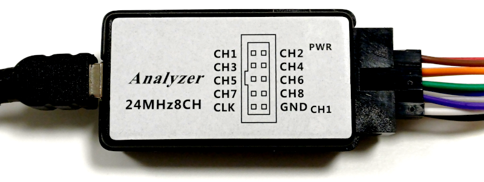

# Meetinstrument de Logic Analyzer

## Introductie

Bij het [Oscilloskoop](../oscilloscope/) hadden we gezien hoe we analoge signalen kunnen zichtbaar maken. Om ook de spanningswaarden juist te zien is redelijk duur electronika nodig. Vandaar zijn de hoeveelheden "Channels" meestal beperkt op twee of vier.

Voor digitale signalen is de exakte spanningswaarde niet erg interessant - als er geen analoge storing op de draad is weten we dat alle signalen "High" of "Low" moeten zijn.

Vaak is het veel interessanter meer signalen tegelijkertijd te zien. Voor deze toepassing werden Logic Analyzers ontwikkeld, een instap-variant daarvan hebben jullie in het TI-S2 kitje.

## Logic Analyzer Hardware

De Logic Analyzer die wij hebben is een goedkope variant van een professioneel toestel, de [Saleae Logic](https://www.saleae.com/logic).

Saleae heeft een nuttig meetprogramma, "Logic 2", deze werkt met de goedkope variant.

## Gebruik van een Logic Analyzer

